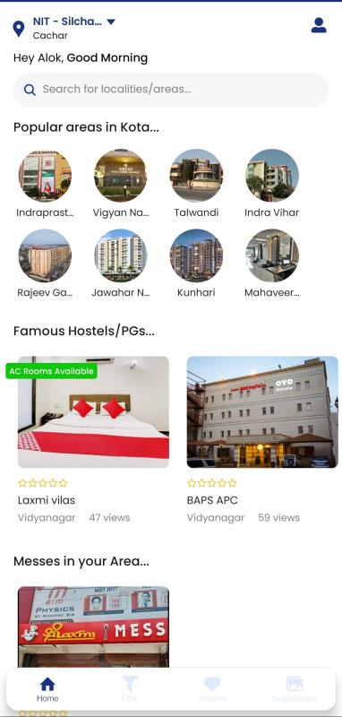
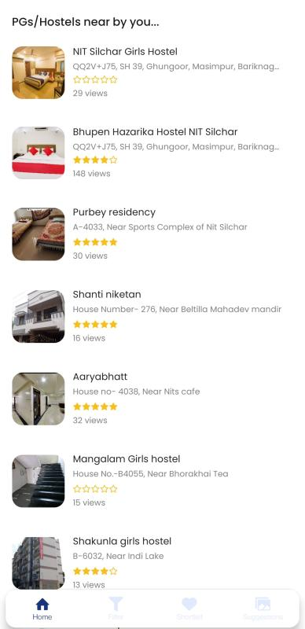
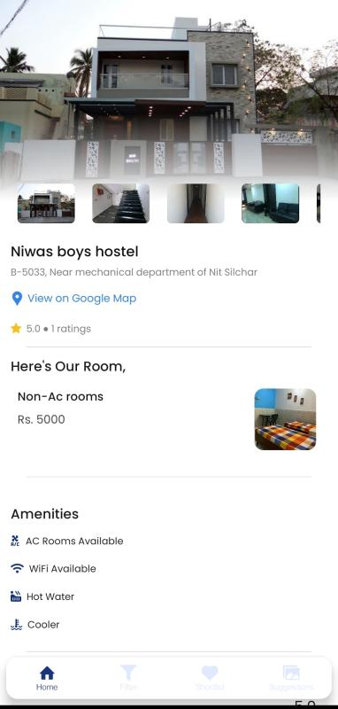
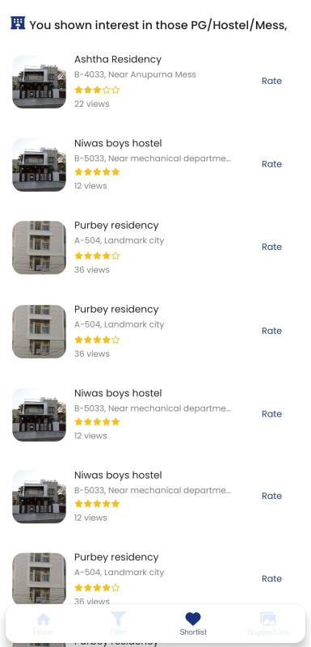
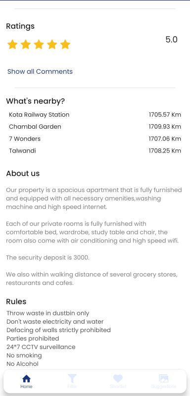
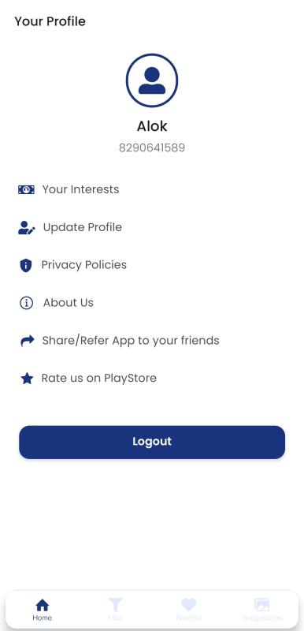

# 🏠 ShelterHub

**A PG, hostel, and mess discovery Android application for students in Kota, Rajasthan.**

ShelterHub was developed as a **client-driven project for alumni of NIT Silchar and NIT Patna**. It helps students explore accommodation options, compare listings, check property details, and shortlist places of interest through a React Native application. The solution is supported by modular Node.js/Express REST APIs and a MongoDB database.

> 👨‍💻 **My contribution:** Worked on **backend development**, building **Node.js/Express REST APIs** that power the ShelterHub Android application. My work focused on server-side functionality and the API layer used by the React Native frontend.

---

## 🎯 Problem Statement

### Finding Reliable Student Accommodation in Kota

Kota attracts students preparing for competitive examinations, many of whom arrive from other cities and need to find a suitable **PG, hostel, or mess** near their preferred area or coaching location.

The accommodation search can be fragmented: students may need to contact multiple property owners, compare rents and facilities manually, and visit several locations to understand whether a property meets their needs. Important information such as amenities, ratings, location, and room availability is not always easy to compare in one place.

The project aimed to make this process easier through a mobile-first discovery platform connecting two major user groups:

- 🎓 **Students** — Discover accommodation, explore property information, view ratings, and save preferred listings.
- 🏘️ **Property owners** — Maintain property/room information and access student interest through backend functionality.

The system also needed an infrastructure design capable of accommodating fluctuating usage as more students accessed the application.

---

## 💡 Solution

**ShelterHub** centralizes accommodation discovery into one Android application, with backend services for user authentication, property search, and owner operations.

### 📱 Student Mobile Application (React Native)

The mobile experience enables students to:

- 🔍 Search PGs, hostels, and mess facilities.
- 📍 Explore popular areas and location-based listings.
- 🏠 Browse recommended and nearby properties.
- 🎛️ Filter properties by rent, rating, occupancy, and available amenities.
- 🛏️ View room details, property photographs, rent, and facilities.
- ⭐ Read ratings and reviews and submit property ratings.
- ❤️ Shortlist properties by expressing interest.
- 🗺️ Access map and location-related functionality.
- 👤 Sign in, manage their profile, and use OTP/password-recovery flows.

### ⚙️ Backend & API Layer (Node.js / Express.js)

The backend is organized into three services:

- 🔐 **Authentication (`Auth/`)** — Registration, login, owner authentication, OTP-related verification, and password-recovery endpoints.
- 🧭 **Student and discovery (`User/`)** — City/area discovery, listing search, nearby properties, filtering, property details, ratings, suggestions, and saved interests.
- 🏘️ **Owner management (`Owner/`)** — Owner profile information, room management, property media uploads, and access to interested-student data.

### ☁️ Cloud Infrastructure (AWS)

The project used **Amazon EC2**, **Elastic Load Balancing (ELB)**, and **Auto Scaling** in its deployment approach to support incoming API traffic and changes in application demand.

---

# 🏗️ Overall System Architecture

The Android frontend communicates with the backend through REST APIs. The services retrieve and update data in MongoDB, while Firebase Storage is used in the media-upload implementation.

```text
                           ShelterHub Platform
                                   │
                        ┌──────────┴──────────┐
                        │                     │
                        ▼                     ▼
                Student Mobile App       Property Owners
                   React Native          Owner API Access
                        │                     │
                        └──────────┬──────────┘
                                   │
                                   ▼
                      AWS Elastic Load Balancer
                                   │
                                   ▼
                     Amazon EC2 Application Layer
                       (AWS Auto Scaling setup)
                                   │
                ┌──────────────────┼───────────────────┐
                │                  │                   │
                ▼                  ▼                   ▼
           Auth Service       User Service        Owner Service
         Node.js/Express     Node.js/Express      Node.js/Express
                │                  │                   │
                └──────────────────┼───────────────────┘
                                   ▼
                            MongoDB Database
                                   │
                     Property media integration
                                   ▼
                             Firebase Storage
```

> **Architecture note:** AWS EC2, ELB, and Auto Scaling reflect the project deployment described above. The repository contains application source code, not infrastructure-as-code or deployment manifests, so the diagram is a high-level representation rather than a verified production topology.

---

# ⚙️ Backend Modules & API Responsibilities

The repository separates authentication, student discovery, and property-owner management to keep different application responsibilities organized.

| Module | Directory | Core responsibilities |
| :--- | :--- | :--- |
| **Authentication** | `Auth/` | Student/owner registration and login, OTP-related flows, and password recovery |
| **User & Discovery** | `User/` | Area/city search, nearby listings, filters, property details, reviews, recommendations, and shortlists |
| **Owner Management** | `Owner/` | Owner profiles, room creation/management, uploads, and student-interest data |
| **Student App** | `pguser/` | React Native screens, navigation, search/filter UI, shortlist, and profile |

### Representative REST APIs

These routes are present in the source code. Some require a `Bearer` token.

| Service | Method | Route | Use |
| :--- | :--- | :--- | :--- |
| Auth | `POST` | `/api/v1/user/register` | Create a student account |
| Auth | `POST` | `/api/v1/user/login` | Student authentication |
| User | `GET` | `/api/v1/user/city` | Retrieve cities |
| User | `GET` | `/api/v1/user/area` | Search areas |
| User | `GET` | `/api/v1/user/:uid/pg` | Search/sort properties |
| User | `GET` | `/api/v1/user/:uid/pg/nearby` | Nearby accommodation |
| User | `POST` | `/api/v1/user/pg/filter` | Filter listings |
| User | `GET` | `/api/v1/user/pg/:pid` | Property details |
| User | `GET` | `/api/v1/user/pg/:pid/reviews` | Property reviews |
| User | `POST` | `/api/v1/user/:uid/pg/:pid/rating` | Add a rating |
| User | `GET` | `/api/v1/user/:uid/interest` | View shortlisted properties |
| User | `POST` | `/api/v1/user/:uid/interest` | Express interest in a property |
| Owner | `POST` | `/api/v1/owner/createroom` | Create a room listing |
| Owner | `GET` | `/api/v1/owner/displayallrooms` | View owner's rooms |

---

# 📱 Application Preview

The screenshots below are taken from the Android application included with the project. They are placed alongside the relevant features, following the walkthrough style of the reference README.

## 🏠 Home & Accommodation Discovery

The home screen provides an entry point for browsing student accommodation in Kota:

- 🔎 Search across locations and areas.
- 📍 Explore popular neighbourhoods.
- 🏘️ See featured PGs and hostels.
- 🍽️ Browse mess facilities.
- 🧭 Navigate to filters, shortlists, and profile sections.



---

## 📍 Nearby PGs & Hostels

The nearby-listing screen presents accommodation options with names, location details, preview photographs, ratings, and listing engagement information. Students can compare multiple properties from a single list.



---

## 🛏️ Property Details & Amenities

Selecting a property opens a detailed page that can include:

- Property and room photographs.
- Available room types and rent.
- AC, Wi-Fi, hot water, cooler, and other amenities.
- Ratings and location-related details.
- Property description, nearby places, and rules.



---

## ❤️ Shortlist & Student Interest

Students can express interest in accommodation options and revisit these entries through the **Shortlist** tab, making it easier to compare places before contacting or visiting them.

The backend stores interest records and provides endpoints for owners to access related information.



---

## ⭐ Ratings, Nearby Places & Property Rules

Property detail screens also show ratings, comments, nearby landmarks, descriptions, and house rules. These details help students evaluate options beyond rent alone.



---

## 👤 Profile & Account Management

The profile screen includes student information and navigation to:

- Saved interests.
- Profile updates.
- Privacy policy and About pages.
- Sharing/referrals and app feedback options.
- Logout.

Authentication-related code also contains registration, login, OTP, and password-recovery flows.



---

# 🔄 Student Discovery Workflow

```text
                         Open ShelterHub
                                ↓
                       Sign In / Register
                                ↓
                           Home Screen
                                ↓
                    Search an Area or Explore
                                ↓
                      Browse PGs / Hostels
                                ↓
                    ┌───────────┴────────────┐
                    │                        │
                  Filter                 Nearby Results
                    │                        │
                    └───────────┬────────────┘
                                ↓
                       Select a Property
                                ↓
                 View Rent, Amenities & Ratings
                                ↓
                     ┌──────────┴──────────┐
                     │                     │
                 Shortlist            Explore Others
                     │                     │
                     ▼                     │
               Saved Interests ◀───────────┘
```

---

# 🛠️ Technology Stack

## 📱 Mobile Application

- **React Native 0.70.2 / JavaScript** — Android application development.
- **React Navigation** — Stack and bottom-tab navigation.
- **Axios** — REST API communication.
- **React Native Maps / Geolocation / Geocoding** — Location-aware UI features.
- **React Native Reanimated, Lottie & Vector Icons** — Mobile interactions and presentation.

## ⚙️ Backend & Data

- **Node.js / Express.js** — REST API services.
- **MongoDB / Mongoose** — Data models and persistent storage.
- **JWT & bcryptjs** — Token-based authentication and password handling.
- **Firebase Storage** — Property media storage in the backend implementation.
- **Helmet, CORS & xss-clean** — HTTP and input-handling middleware present in the services.

## ☁️ Infrastructure

- **AWS EC2** — Compute for the application backend.
- **AWS Elastic Load Balancing** — Incoming request distribution.
- **AWS Auto Scaling** — Capacity adjustment for variable traffic (as used in the project deployment).

---

# 🧩 Key Features

### Student Experience

- 🔍 PG, hostel, and mess discovery.
- 📍 Area search and nearby accommodation.
- 🎛️ Filters for budget, ratings, occupancy, and amenities.
- 🛏️ Property photos, prices, and room details.
- ⭐ Ratings, reviews, and property information.
- ❤️ Saved interests/shortlisting.
- 👤 Authentication and profile management.

### Owner & Backend Operations

- 🏘️ Owner authentication and profiles.
- 🛠️ Room listing creation and updates.
- 📸 Media-upload integration.
- 📋 Interested-student records.
- 🔐 Protected API endpoints and modular backend routing.

---

# 🚀 Project Outcome

ShelterHub was developed to address a practical student-housing discovery need in Kota for a client group comprising alumni of **NIT Silchar and NIT Patna**.

The project delivered a working React Native Android application with property discovery, location-aware listings, filters, detailed property views, ratings, and saved interests, backed by Express APIs and MongoDB.

Its deployment architecture incorporated **EC2, ELB, and Auto Scaling** to accommodate changes in traffic. The repository does **not** include public performance benchmarks or infrastructure manifests, so no specific uptime, user-count, or throughput figures are claimed here.

---

# 👨‍💻 My Contribution

My primary contribution to ShelterHub was **backend development using Node.js and Express.js**, creating REST APIs consumed by the React Native Android application.

My work focused on:

- **Building Node.js/Express REST API endpoints** to support communication between the Android app and backend services.
- **Implementing server-side request handling** for the app's accommodation-discovery and user/owner workflows.
- **Working within the modular API architecture** covering authentication (`Auth/`), student operations (`User/`), and owner operations (`Owner/`).
- **Supporting data access through the backend**, which uses MongoDB/Mongoose to manage application information.

The **React Native frontend** and **AWS EC2, ELB, and Auto Scaling infrastructure** are part of the overall project; they are not presented here as my personal contributions.

---

# 📚 Project Background

| Detail | Information |
| :--- | :--- |
| **Project** | ShelterHub — PG/Hostel Discovery App |
| **Type** | Client-driven project |
| **Client context** | Alumni of NIT Silchar and NIT Patna |
| **Target users** | Students seeking accommodation in Kota, Rajasthan |
| **Platform** | Android (React Native) |
| **My focus** | Backend development — Node.js/Express REST APIs |
| **Core technologies** | React Native, Node.js, Express.js, MongoDB, AWS |

---

# 📁 Project Structure

```text
ShelterHub/
│
├── pguser/                  # React Native mobile application
│   ├── screens/             # Home, filters, authentication, profile, etc.
│   ├── components/          # Reusable mobile UI components
│   ├── Router/              # Navigation
│   ├── src/Context/         # Application context
│   ├── android/             # Native Android project
│   ├── ios/                 # Native iOS project
│   └── package.json
│
├── Auth/                    # User/owner authentication service
├── User/                    # Discovery, listings, ratings, interests APIs
├── Owner/                   # Owner and room-management APIs
│
├── Screenschots/            # Six original Android screenshots
│   ├── 1750483195406.jpg
│   ├── 1750483227169.jpg
│   ├── 1750483252558.jpg
│   ├── 1750483273588.jpg
│   ├── 1750483302471.jpg
│   └── 1750483350411.jpg
│
└── README.md
```

---

# 🚀 Getting Started

> The project uses an older React Native dependency stack and requires project-specific service credentials. The steps below describe the source configuration; they are not a guarantee that the historical application runs without dependency updates.

### Prerequisites

- Node.js and npm.
- Android Studio and the Android SDK.
- An Android emulator or physical Android device.
- A compatible React Native development environment.
- MongoDB access and Firebase Storage configuration where needed.
- Required API/provider credentials for authentication-related flows.

### 1. Clone the repository

```bash
git clone https://github.com/shahkandarp/ShelterHub.git
cd ShelterHub
```

### 2. Configure and run the backend

Each service has its own `package.json` and uses environment variables. Configure local, untracked `.env` files for `Auth/`, `User/`, and `Owner/` with the variables used in the corresponding service.

Examples of variables referenced in the source include `MONGO_URI`, `JWT_SECRET_USER`, `JWT_SECRET_OWNER`, `JWT_LIFETIME`, and `PORT`. Some authentication flows require additional provider credentials, and media handling requires Firebase configuration.

Run each API service in a different terminal:

```bash
cd Auth
npm install
npm start
```

```bash
cd User
npm install
npm start
```

```bash
cd Owner
npm install
npm start
```

The backend defaults used in the source are `3001` (Auth), `8000` (User), and `4000` (Owner), unless overridden.

### 3. Configure and launch the Android application

The mobile application reads some configuration via `react-native-dotenv`; configure a local `pguser/.env` to match your environment. **Some source files use a hard-coded HTTP AWS load-balancer URL**, so changing environment variables alone may not redirect every request. Update those API call sites or centralize the API base URL before using local services.

```bash
cd pguser
npm install
npm start
```

Open another terminal from `pguser/`:

```bash
npm run android
```

On the standard Android emulator, `10.0.2.2` can be used to reach services running on the host machine, where networking permits.

### Configuration and security

- Do **not** commit real `.env` files, database passwords, provider keys, or JWT signing secrets.
- Review and rotate any credentials previously present in Git history.
- Replace hard-coded HTTP URLs with configurable **HTTPS** endpoints before deployment.
- Validate backend authorization and Firebase rules for your deployment environment.
- Review outdated dependencies and security advisories before rebuilding the app.

---

# 🏠 From Student Need to Application

```text
        Student Accommodation Search in Kota
                       ↓
              Client Requirements
           (NIT Alumni Project)
                       ↓
             Mobile Experience Design
                       ↓
              React Native Android App
                       ↓
        Node.js / Express REST API Services
                       ↓
          MongoDB & Firebase Integration
                       ↓
        AWS EC2 + ELB + Auto Scaling Setup
                       ↓
        PG / Hostel Discovery & Shortlisting
```

---

**ShelterHub — Making student accommodation discovery more convenient in Kota.**
